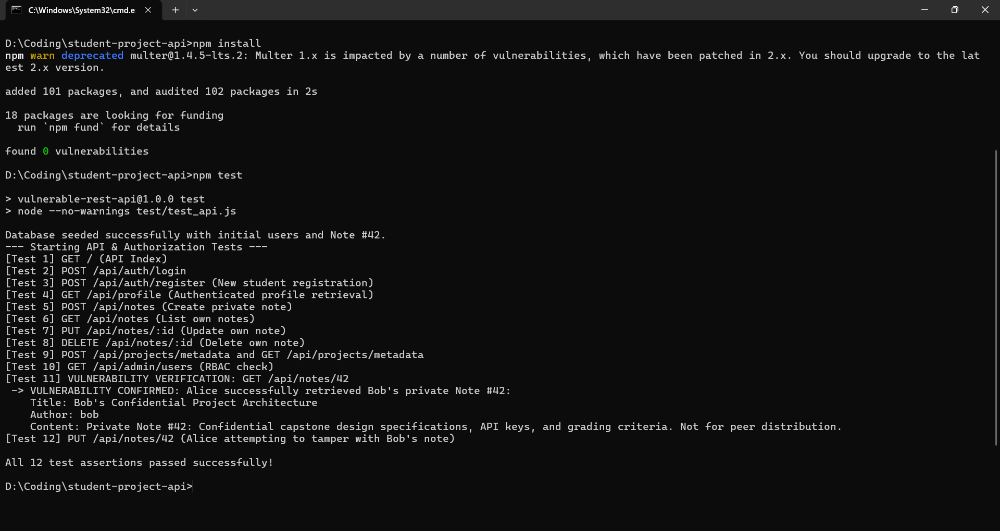
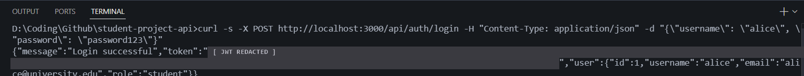
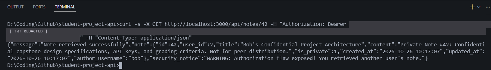
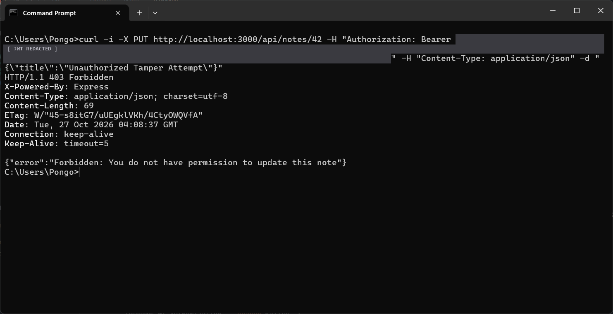
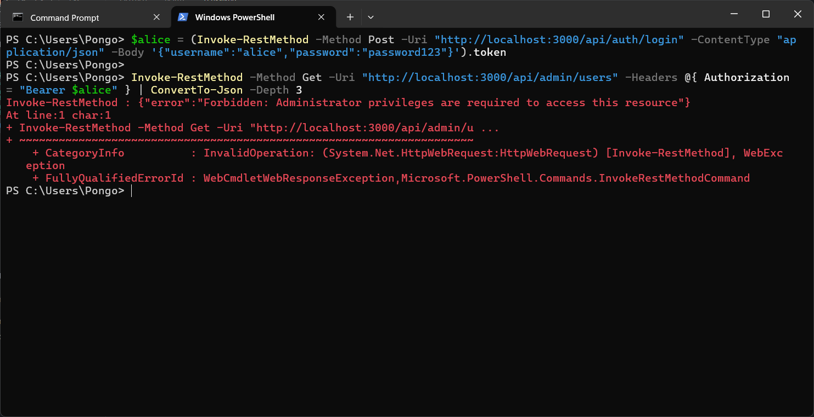
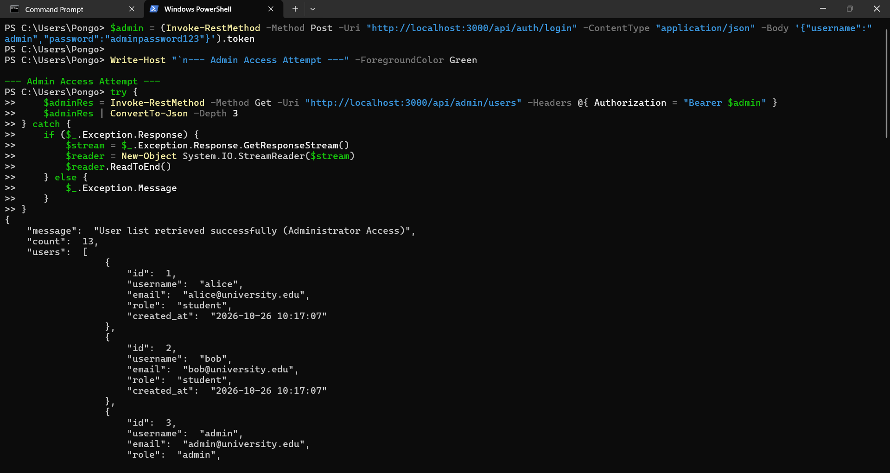
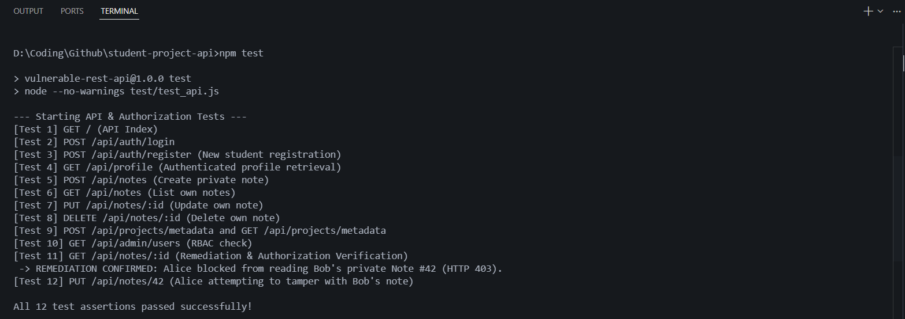

# Cybersecurity Vulnerability Case Study & API Security Audit
## Broken Object Level Authorization (BOLA / IDOR) in Student Project Management API

- **Target Application**: Student Project Management REST API (`student-project-api`)
- **Author / Researcher**: Shevanka Kurniawan (`shevanka.kurniawan@gmail.com`)
- **Assessment Date**: October 26, 2026
- **Repository**: [https://github.com/Shevanka/student-project-api](https://github.com/Shevanka/student-project-api)
- **Vulnerable Baseline Commit**: `81646e8acf16aab5e87cdac7524bbfdb1f85c0aa`
- **Remediation Commit**: `b67a46df44f4ed2832431f307c35c444db56e071` (merged to `main` in PR #1)
- **Verification Date**: November 18, 2026

---

## 1. Executive Summary

This vulnerability case study and security audit evaluates the authorization architecture of the **Student Project Management API**, a Node.js/Express service designed for academic project collaboration, note-keeping, and artifact metadata management.

### Version Distinction & Remediation Context
- **Original Vulnerable Baseline (initial commit `81646e8`)**:
  Contained a Broken Object Level Authorization (BOLA/IDOR) vulnerability on the private note retrieval endpoint (`GET /api/notes/:id`). While incoming requests were cryptographically authenticated via JSON Web Tokens (JWT), the controller executed direct database lookups using client-supplied path parameters without verifying resource ownership. Any authenticated student could read any peer student's private capstone research notes (demonstrated using Note #42).
- **Remediated Version (commit `b67a46d`, merged to `main` in PR #1)**:
  Applies an explicit object-level policy enforcement guard in the `GET /api/notes/:id` controller. The endpoint strictly enforces that `note.user_id === req.user.id || req.user.role === 'admin'`, rejecting unauthorized cross-student reads with `HTTP 403 Forbidden`. Comprehensive regression test assertions were integrated to prevent authorization regressions.

### Vulnerability Metadata & Status
- **Vulnerability**: Broken Object Level Authorization (BOLA) / Insecure Direct Object Reference (IDOR)
- **OWASP Classification**: **OWASP API Security Top 10 2023 - API1:2023 Broken Object Level Authorization**
- **CWE Identifier**: **CWE-639** (Authorization Bypass Through User-Controlled Key) / **CWE-284** (Improper Access Control)
- **CVSS v3.1 Score**: **6.5 (Medium)** — `CVSS:3.1/AV:N/AC:L/PR:L/UI:N/S:U/C:H/I:N/A:N`
- **Affected Endpoint**: `GET /api/notes/:id` (demonstrated via Note #42)
- **Current Finding Status**: **Remediated — verified** by the regression suite on `main` (November 18, 2026): Alice receives `403` for Note #42, Bob and the administrator receive `200`, unauthenticated requests receive `401`.

---

## 2. System Architecture & Route Inventory

### 2.1 Repository Map

| Path | Primary Component / Responsibility | Security Significance |
| :--- | :--- | :--- |
| `src/server.js` | HTTP Server bootstrap on port 3000 | Configures port binding and process lifecycle. |
| `src/app.js` | Express app middleware & route aggregation | Centralizes route mounting, JSON parsing, error handling. |
| `src/db.js` | SQLite initialization (`node:sqlite`) & seeding | Schema definitions, foreign key enforcement, default seed data. |
| `src/middleware/auth.js` | JWT verification & Role enforcement | Handles `authenticateToken` and `requireAdmin` guards. |
| `src/routes/auth.js` | Authentication handlers | User registration (`/register`) and credential login (`/login`). |
| `src/routes/profile.js` | Self-profile handler | Identity reflection (`/profile`) bounded by `req.user.id`. |
| `src/routes/notes.js` | Notes CRUD management | Ownership checks on `GET`/`PUT`/`DELETE /:id` (the `GET` check was missing before `b67a46d`). |
| `src/routes/projects.js` | Multipart project metadata upload | Multer disk storage and metadata indexing. |
| `src/routes/admin.js` | Administrative user directory | Role-gated endpoint (`requireAdmin`) listing registered users. |
| `test/test_api.js` | End-to-end regression & security test suite | Programmatic proof of concept and authorization validations. |

### 2.2 Route & Security Control Matrix

| Method | Endpoint | Authentication | Authorization Guard | Access Boundary / Scope | Status |
| :--- | :--- | :--- | :--- | :--- | :--- |
| `POST` | `/api/auth/register` | None (Public) | None | Creates user with fixed `student` role | Secure |
| `POST` | `/api/auth/login` | None (Public) | Credential check | Issues signed JWT token | Secure |
| `GET` | `/api/profile` | Bearer JWT | Identity Bound | Scoped strictly to `req.user.id` | Secure |
| `POST` | `/api/notes` | Bearer JWT | Identity Bound | Assigns `user_id = req.user.id` | Secure |
| `GET` | `/api/notes` | Bearer JWT | Query Scoped | `WHERE user_id = req.user.id` | Secure |
| `GET` | `/api/notes/:id` | Bearer JWT | Policy Check | `note.user_id === req.user.id \|\| admin` | Remediated — verified |
| `PUT` | `/api/notes/:id` | Bearer JWT | Object Ownership | Verifies `note.user_id === req.user.id \|\| admin` | Secure |
| `DELETE` | `/api/notes/:id` | Bearer JWT | Object Ownership | Verifies `note.user_id === req.user.id \|\| admin` | Secure |
| `POST` | `/api/projects/metadata` | Bearer JWT | Identity Bound | Assigns `user_id = req.user.id` | Audit Flag |
| `GET` | `/api/projects/metadata` | Bearer JWT | Query Scoped | Scoped to `user_id = req.user.id` | Secure |
| `GET` | `/api/admin/users` | Bearer JWT | RBAC (`role === 'admin'`) | Restricted to administrative accounts | Secure |

---

## 3. Vulnerability Case Study: Broken Object Level Authorization

### 3.1 Root Cause & Historical Pre-Fix Implementation

Broken Object Level Authorization (BOLA) occurs when an application receives a user-supplied identifier to access an internal object and fails to validate whether the authenticated actor possesses authorization rights for that specific object instance.

> [!NOTE] Historical Evidence (Pre-Fix Implementation — Commit `81646e8acf`)
> The code excerpt below documents the **original vulnerable implementation** of `GET /api/notes/:id` in [`src/routes/notes.js`](../src/routes/notes.js). It is preserved here as forensic and research evidence to illustrate the missing policy enforcement point.

```javascript
// PRE-FIX IMPLEMENTATION (Vulnerable to BOLA / IDOR - Historical Baseline)
router.get('/:id', authenticateToken, (req, res) => {
  const noteId = parseInt(req.params.id, 10);

  if (isNaN(noteId)) {
    return res.status(400).json({ error: 'Invalid note ID' });
  }

  try {
    // Retrieve note by ID
    const note = db
      .prepare(`
        SELECT notes.*, users.username AS author_username
        FROM notes
        JOIN users ON notes.user_id = users.id
        WHERE notes.id = ?
      `)
      .get(noteId);

    if (!note) {
      return res.status(404).json({ error: 'Note not found' });
    }

    // FLAW: The controller returns the record immediately.
    // It verifies THAT the user is logged in (via authenticateToken),
    // but never checks IF note.user_id matches req.user.id!
    return res.status(200).json({
      message: 'Note retrieved successfully',
      note,
      security_notice:
        note.user_id !== req.user.id
          ? 'WARNING: Authorization flaw exposed! You retrieved another user\'s note.'
          : 'Normal access: You own this note.',
    });
  } catch (error) {
    return res.status(500).json({ error: 'Failed to retrieve note', details: error.message });
  }
});
```

#### The Architecture Disconnect: Authentication vs. Authorization

```
+------------------+         +--------------------------+         +----------------------------+
|  HTTP Request    |  JWT OK |  authenticateToken (MW)  | Pass To |  GET /api/notes/:id Route  |
|  GET /notes/42   | ------> |  req.user = Alice (ID 1) | ------> |  Query: SELECT * WHERE id=42
+------------------+         +--------------------------+         +----------------------------+
                                                                                 |
                                                                                 v
                                                                  +----------------------------+
                                                                  |  Result: Bob's Note (ID 2) |
                                                                  |  NO OWNERSHIP CHECK!       |
                                                                  |  Returned to Alice (200 OK)|
                                                                  +----------------------------+
```

1. **Authentication Check Succeeded**: `authenticateToken` verified that the request had a valid Bearer token for Alice (`id: 1, role: 'student'`).
2. **Object Identification**: The controller parsed `noteId = 42` from the URI route parameter.
3. **Missing Policy Enforcement Point (PEP)**: The application queried the database directly using only `notes.id = 42`.
4. **Contrast with Sister Endpoints**: In `PUT /api/notes/:id` and `DELETE /api/notes/:id`, the developer correctly inserted:
   ```javascript
   if (existingNote.user_id !== req.user.id && req.user.role !== 'admin') {
     return res.status(403).json({ error: 'Forbidden: You do not have permission...' });
   }
   ```
   Omitting this check from the `GET` handler created an asymmetric authorization boundary where unauthorized reads succeed, even though writes are prevented.

### 3.2 Threat Model & Exploitation Walkthrough

- **Threat Actor**: Authenticated Student (e.g., Alice, Student ID 1).
- **Target Asset**: Confidential project notes and intellectual property belonging to peer students (e.g., Bob, Student ID 2, Note #42).
- **Motivation**: Academic espionage, plagiarizing capstone projects, exfiltrating pre-release research notes or grading credentials.
- **Attack Vector**: Horizontal Privilege Escalation via parameter enumeration.

#### Step-by-Step Reproduction Flow

1. **Attacker Authentication**:
   Alice logs in to obtain a valid session token:
   ```http
   POST /api/auth/login HTTP/1.1
   Host: localhost:3000
   Content-Type: application/json

   {"username": "alice", "password": "password123"}
   ```
   *Response*: `200 OK` with JWT token `eyJhbGciOiJIUzI1NiIsInR5cCI6IkpXVCJ9...` (`id: 1`, `role: 'student'`).

2. **Enumeration Request**:
   Alice targets Note identifier `42`:
   ```http
   GET /api/notes/42 HTTP/1.1
   Host: localhost:3000
   Authorization: Bearer <ALICE_JWT_TOKEN>
   ```

3. **Vulnerable Response**:
   ```http
   HTTP/1.1 200 OK
   Content-Type: application/json

   {
     "message": "Note retrieved successfully",
     "note": {
       "id": 42,
       "user_id": 2,
       "title": "Bob's Confidential Project Architecture",
       "content": "Private Note #42: Confidential capstone design specifications, API keys, and grading criteria. Not for peer distribution.",
       "is_private": 1,
       "created_at": "2026-10-26 10:17:07",
       "updated_at": "2026-10-26 10:17:07",
       "author_username": "bob"
     },
     "security_notice": "WARNING: Authorization flaw exposed! You retrieved another user's note."
   }
   ```

4. **Result**: Complete confidentiality loss of Bob's private note #42 to an unauthorized peer student.

#### Asymmetric Authorization Control: Write Denied

The same authenticated Alice session cannot modify Bob's note. This confirms that
the authorization boundary is enforced for writes but missing for the vulnerable
read operation:

```http
PUT /api/notes/42 HTTP/1.1
Host: localhost:3000
Authorization: ******
Content-Type: application/json

{"title":"Unauthorized Tamper Attempt"}
```

```http
HTTP/1.1 403 Forbidden
Content-Type: application/json; charset=utf-8

{"error":"Forbidden: You do not have permission to update this note"}
```

This asymmetric result—`GET /api/notes/42` returns Bob's private note with
`200 OK`, while `PUT /api/notes/42` returns `403 Forbidden`—demonstrates that
the defect is specifically an object-level authorization failure in the read
handler, not a general authentication bypass.

---

## 4. Remediation & Defensive Implementation

### 4.1 Actual Remediated Implementation (The Applied Fix)

The primary BOLA vulnerability in `GET /api/notes/:id` was resolved by implementing an explicit object-level authorization policy guard in [`src/routes/notes.js`](../src/routes/notes.js), directly matching the existing ownership enforcement pattern used in `PUT` and `DELETE`.

#### The Active Implementation
```javascript
// REMEDIATED IMPLEMENTATION (Active in src/routes/notes.js)
router.get('/:id', authenticateToken, (req, res) => {
  const noteId = parseInt(req.params.id, 10);

  if (isNaN(noteId)) {
    return res.status(400).json({ error: 'Invalid note ID' });
  }

  try {
    // Retrieve note by ID
    const note = db
      .prepare(`
        SELECT notes.*, users.username AS author_username
        FROM notes
        JOIN users ON notes.user_id = users.id
        WHERE notes.id = ?
      `)
      .get(noteId);

    if (!note) {
      return res.status(404).json({ error: 'Note not found' });
    }

    // Object-level authorization check: Only the owner (or admin) can view the note
    if (note.user_id !== req.user.id && req.user.role !== 'admin') {
      return res.status(403).json({
        error: 'Forbidden: You do not have permission to view this note',
      });
    }

    return res.status(200).json({
      message: 'Note retrieved successfully',
      note,
    });
  } catch (error) {
    return res.status(500).json({ error: 'Failed to retrieve note', details: error.message });
  }
});
```

#### Remediation Diff
```diff
--- a/src/routes/notes.js
+++ b/src/routes/notes.js
@@ -98,19 +98,16 @@ router.get('/:id', authenticateToken, (req, res) => {
       return res.status(404).json({ error: 'Note not found' });
     }
 
-    // -------------------------------------------------------------------------
-    // VULNERABILITY: Missing Object-Level Ownership Verification!
-    // The code only checks if the caller is authenticated (req.user exists),
-    // but never validates that note.user_id === req.user.id.
-    // -------------------------------------------------------------------------
+    // Object-level authorization check: Only the owner (or admin) can view the note
+    if (note.user_id !== req.user.id && req.user.role !== 'admin') {
+      return res.status(403).json({
+        error: 'Forbidden: You do not have permission to view this note',
+      });
+    }
 
     return res.status(200).json({
       message: 'Note retrieved successfully',
       note,
-      security_notice:
-        note.user_id !== req.user.id
-          ? 'WARNING: Authorization flaw exposed! You retrieved another user\'s note.'
-          : 'Normal access: You own this note.',
     });
```

### 4.2 Architectural Alternatives (Query-Level Scoping vs. Policy Guards)

Access control can be structured using either **database query-level scoping** or **post-query controller guards**:

#### Option A: Database Query-Level Tenant Scoping (Alternative for Multi-Tenant Isolation)
By scoping the SQL query directly to the requesting tenant's ID, unauthorized records simply resolve to `null`, so non-existent and unauthorized notes both return `404` and the response reveals nothing about which IDs exist:

```diff
- const note = db
-   .prepare(`
-     SELECT notes.*, users.username AS author_username
-     FROM notes
-     JOIN users ON notes.user_id = users.id
-     WHERE notes.id = ?
-   `)
-   .get(noteId);
+ const query = req.user.role === 'admin'
+   ? 'SELECT notes.*, users.username AS author_username FROM notes JOIN users ON notes.user_id = users.id WHERE notes.id = ?'
+   : 'SELECT notes.*, users.username AS author_username FROM notes JOIN users ON notes.user_id = users.id WHERE notes.id = ? AND notes.user_id = ?';
+
+ const note = req.user.role === 'admin'
+   ? db.prepare(query).get(noteId)
+   : db.prepare(query).get(noteId, req.user.id);
```

#### Option B: Post-Query Policy Guard (Active Implementation)
Fetches the record by identifier and validates `note.user_id === req.user.id || req.user.role === 'admin'`, explicitly returning `HTTP 403 Forbidden` if authorization fails. This matches the behavior of sister endpoints `PUT` and `DELETE`.

**Accepted trade-off:** because a missing note returns `404` and another user's note returns `403`, a caller can still tell which note IDs exist. No note content is disclosed, and IDs are sequential integers that are guessable anyway, so this was accepted for consistency with `PUT` and `DELETE`. Option A removes the signal if existence itself must stay confidential.

---

## 5. Comprehensive API Security Audit Findings

Beyond the primary BOLA vulnerability, a full whitebox security audit of the repository identified the following concrete findings and hardening opportunities:

```
+-------------------------------------------------------------------------------------------------------------------------------+
| ID       | Severity | Vulnerability / Issue Description                | Affected Component        | Status                   |
+-------------------------------------------------------------------------------------------------------------------------------+
| SEC-001  | MEDIUM   | Broken Object Level Authorization (BOLA/IDOR)    | src/routes/notes.js       | Remediated — verified    |
| SEC-002  | MEDIUM   | Hardcoded Default JWT Secret Fallback            | src/middleware/auth.js    | Identified               |
| SEC-003  | MEDIUM   | Unrestricted File Upload Types in Multer         | src/routes/projects.js    | Identified               |
| SEC-004  | LOW      | Missing Rate Limiting on Authentication Endpoints| src/routes/auth.js        | Identified               |
| SEC-005  | LOW      | Sensitive Default Credential Exposure            | src/app.js (Root index)   | Identified               |
| SEC-006  | LOW      | Missing HTTP Security Headers (Helmet, CORS)     | src/server.js / src/app.js| Identified               |
| SEC-007  | INFO     | Internal Stack / Error Detail Exposure           | src/app.js (Error Handler)| Identified               |
+-------------------------------------------------------------------------------------------------------------------------------+
```

### Finding SEC-002: Hardcoded Default JWT Secret Fallback (Medium)
- **Location**: `src/middleware/auth.js` line 3:
  ```javascript
  const JWT_SECRET = process.env.JWT_SECRET || 'secret-jwt-key-for-lab-environment-123';
  ```
- **Risk**: If deployed without explicitly defining `process.env.JWT_SECRET`, an attacker possessing the source repository can forge arbitrary JWT tokens with `{ role: 'admin' }`, achieving complete administrative takeover (`GET /api/admin/users`).
- **Remediation**: Require `JWT_SECRET` in environment variables during application startup, and terminate process execution if omitted in non-test environments:
  ```javascript
  if (!process.env.JWT_SECRET && process.env.NODE_ENV === 'production') {
    throw new Error('FATAL: JWT_SECRET environment variable is missing.');
  }
  ```

### Finding SEC-003: Unrestricted File Upload Extensions & MIME Types (Medium)
- **Location**: `src/routes/projects.js` lines 27–30:
  ```javascript
  const upload = multer({
    storage,
    limits: { fileSize: 5 * 1024 * 1024 },
  });
  ```
- **Risk**: The Multer configuration enforces a 5MB size limit but lacks a `fileFilter`. An authenticated student can upload executable binaries, `.html`, `.svg` (with embedded JavaScript), or shell scripts to the server filesystem.
- **Remediation**: Implement a strict allowlist for file extensions and MIME types:
  ```javascript
  const upload = multer({
    storage,
    limits: { fileSize: 5 * 1024 * 1024 },
    fileFilter: (req, file, cb) => {
      const allowedMimes = ['application/pdf', 'application/json', 'text/plain'];
      if (!allowedMimes.includes(file.mimetype)) {
        return cb(new Error('Invalid file type. Only PDF, JSON, and TXT are permitted.'));
      }
      cb(null, true);
    },
  });
  ```

### Finding SEC-004: Missing Rate Limiting on Authentication Endpoints (Low)
- **Location**: `src/routes/auth.js` (`POST /api/auth/login`, `POST /api/auth/register`)
- **Risk**: Endpoints lack rate limiting, exposing user credentials to offline dictionary attacks and online brute-force credential stuffing.
- **Remediation**: Integrate `express-rate-limit`:
  ```javascript
  const rateLimit = require('express-rate-limit');
  const authLimiter = rateLimit({ windowMs: 15 * 60 * 1000, max: 10 });
  router.use('/login', authLimiter);
  ```

### Finding SEC-005: Demo Credentials Exposed in Root Route (Low)
- **Location**: `src/app.js` lines 48–52:
  `GET /` returns plain text passwords (`password123`, `adminpassword123`).
- **Remediation**: Conditionally disable demo credential exposure when `NODE_ENV === 'production'`.

### Finding SEC-006: Missing HTTP Security Headers (Low)
- **Location**: `src/app.js`
- **Risk**: Missing `X-Frame-Options`, `Content-Security-Policy`, `X-Content-Type-Options`, and `X-Powered-By: Express` header is broadcasted.
- **Remediation**: Add `helmet` middleware:
  ```javascript
  const helmet = require('helmet');
  app.use(helmet());
  ```

### Finding SEC-007: Internal Error Detail Exposure (Info)
- **Location**: the central error handler in `src/app.js` (`details: err.message`) and the `500` responses in `src/routes/*.js`, which all return `details: error.message`.
- **Risk**: Raw exception messages from SQLite, bcrypt and Node reach the client and reveal implementation details useful for further probing. Reproduced on November 18, 2026:
  ```http
  POST /api/auth/register  {"username":{"x":1},"email":"e@x.edu","password":"p"}
  → 500 {"error":"Internal server error","details":"Unknown named parameter 'x'"}

  POST /api/auth/login  {"username":"alice","password":{"x":1}}
  → 500 {"error":"Internal server error","details":"Illegal arguments: object, string"}
  ```
- **Remediation**: Log the error server-side and return a generic message; include `details` only outside production. Validating that request fields are strings would also turn these cases into `400` responses.
  ```javascript
  app.use((err, req, res, next) => {
    console.error('Unhandled Server Error:', err);
    res.status(500).json({ error: 'Internal server error' });
  });
  ```

---

## 6. Evidence & Verification

This section collects the test logs, screenshots, and repository history that support the findings above.

### 6.1 Automated Test Suite Verification

The test suite (`test/test_api.js`) runs 12 test cases against the current `main`:

```
[PASS] Test 1:  GET / (API Root Index & Documentation)
[PASS] Test 2:  POST /api/auth/login (Alice, Bob, Admin authentication; missing body → 400)
[PASS] Test 3:  POST /api/auth/register (New student registration; missing body → 400)
[PASS] Test 4:  GET /api/profile (Authenticated profile retrieval & unauthenticated 401 check)
[PASS] Test 5:  POST /api/notes (Creation of private student project note; missing body → 400)
[PASS] Test 6:  GET /api/notes (Scoping check: only own notes returned)
[PASS] Test 7:  PUT /api/notes/:id (Authenticated owner note update; empty update leaves note unchanged)
[PASS] Test 8:  DELETE /api/notes/:id (Authenticated owner note deletion)
[PASS] Test 9:  POST & GET /api/projects/metadata (Project metadata upload & listing; missing body → 400)
[PASS] Test 10: GET /api/admin/users (RBAC enforcement: Alice denied with 403, Admin allowed with 200)
[PASS] Test 11: GET /api/notes/:id (401 unauthenticated; owner 200; Alice → Bob's Note #42 403; admin 200)
[PASS] Test 12: PUT & DELETE /api/notes/42 (Write protection check: Alice denied with 403 on Bob's note)
```

Before the remediation, Test 11 asserted the flaw instead: Alice received Bob's Note #42 with `200 OK`.

#### Pre-Remediation Baseline Execution Log

Captured at commit `81646e8` (see also Screenshot 0). Note content redacted.

```text
> vulnerable-rest-api@1.0.0 test
> node --no-warnings test/test_api.js

--- Starting API & Authorization Tests ---
[Test 1] GET / (API Index)
[Test 2] POST /api/auth/login
[Test 3] POST /api/auth/register (New student registration)
[Test 4] GET /api/profile (Authenticated profile retrieval)
[Test 5] POST /api/notes (Create private note)
[Test 6] GET /api/notes (List own notes)
[Test 7] PUT /api/notes/:id (Update own note)
[Test 8] DELETE /api/notes/:id (Delete own note)
[Test 9] POST /api/projects/metadata and GET /api/projects/metadata
[Test 10] GET /api/admin/users (RBAC check)
[Test 11] VULNERABILITY VERIFICATION: GET /api/notes/42
 -> VULNERABILITY CONFIRMED: Alice successfully retrieved Bob's private Note #42:
    Title: Bob's Confidential Project Architecture
    Author: bob
    Content: [redacted]
[Test 12] PUT /api/notes/42 (Alice attempting to tamper with Bob's note)

All 12 test assertions passed successfully!
```

#### Post-Remediation Verification Log

Captured at commit `b67a46d` (see Screenshot 5); the output on the current `main` is identical.

```text
> vulnerable-rest-api@1.0.0 test
> node --no-warnings test/test_api.js

--- Starting API & Authorization Tests ---
[Test 1] GET / (API Index)
[Test 2] POST /api/auth/login
[Test 3] POST /api/auth/register (New student registration)
[Test 4] GET /api/profile (Authenticated profile retrieval)
[Test 5] POST /api/notes (Create private note)
[Test 6] GET /api/notes (List own notes)
[Test 7] PUT /api/notes/:id (Update own note)
[Test 8] DELETE /api/notes/:id (Delete own note)
[Test 9] POST /api/projects/metadata and GET /api/projects/metadata
[Test 10] GET /api/admin/users (RBAC check)
[Test 11] GET /api/notes/:id (Remediation & Authorization Verification)
 -> REMEDIATION CONFIRMED: Alice blocked from reading Bob's private Note #42 (HTTP 403).
[Test 12] PUT /api/notes/42 (Alice attempting to tamper with Bob's note)

All 12 test assertions passed successfully!
```

---

### 6.2 Screenshot Evidence

The following terminal captures verify the vulnerability lifecycle. JWT values in Screenshots 1–3 are redacted.

- [x] **Screenshot 0: Terminal — Pre-Remediation Test Suite Execution**
  - *Action*: Run `npm install` and `npm test` at the vulnerable baseline (`81646e8`).
  - *Evidence*: Test 11 confirms Alice retrieves Bob's private Note #42; all 12 assertions pass against the vulnerable code.

  

- [x] **Screenshot 1: Terminal (cURL) — Student Authentication**
  - *Action*: Send `POST /api/auth/login` with `{"username": "alice", "password": "password123"}`.
  - *Evidence*: HTTP 200 OK with Alice's signed JWT token.
  
  

- [x] **Screenshot 2: Terminal (cURL) — The BOLA Exploitation (`GET /api/notes/42`)**
  - *Action*: Send `GET /api/notes/42` with header `Authorization: Bearer <ALICE_TOKEN>`.
  - *Evidence*: HTTP 200 OK returning Bob's private capstone note (`user_id: 2`, `author_username: "bob"`).
  
  

- [x] **Screenshot 3: Terminal (cURL) — Asymmetric Write Protection (`PUT /api/notes/42`)**
  - *Action*: Send `PUT /api/notes/42` with header `Authorization: Bearer <ALICE_TOKEN>`.
  - *Evidence*: HTTP 403 Forbidden (`Forbidden: You do not have permission to update this note`).
  
  

- [x] **Screenshot 4: PowerShell (`Invoke-RestMethod`) — RBAC Gate Verification (`GET /api/admin/users`)**
  - *Action*: Send `GET /api/admin/users` as Alice (Student) and as Admin.
  - *Evidence*: Student receives HTTP 403 Forbidden (4a); Administrator receives HTTP 200 OK with the user directory (4b).
  
  
  

- [x] **Screenshot 5: Terminal — Post-Remediation Test Suite Execution**
  - *Action*: Run `npm test` after the remediation (`b67a46d`).
  - *Evidence*: Test 11 confirms Alice is blocked from Bob's Note #42 with HTTP 403; all 12 assertions pass.
  
  

---

### 6.3 Git History & Repository Integrity

| Property | Value |
| :--- | :--- |
| **Repository URL** | `https://github.com/Shevanka/student-project-api` |
| **Branch** | `main` |
| **Vulnerable Baseline** | `81646e8acf16aab5e87cdac7524bbfdb1f85c0aa` (initial commit) |
| **Remediation Commit** | `b67a46df44f4ed2832431f307c35c444db56e071` |
| **Merged Via** | PR #1 (`research/bola-remediation` → `main`, merge commit `db1530d`) |
| **Author Name** | Shevanka Kurniawan |
| **Author Email** | `shevanka.kurniawan@gmail.com` |
| **Files Changed by the Fix** | `src/routes/notes.js`, `test/test_api.js` |

To reproduce the original flaw, check out the baseline in a separate worktree
(`git worktree add ../student-project-api-baseline 81646e8`), run `npm install`, and
follow Section 3.2.

---

## 7. Researcher Conclusion

This audit demonstrates a fundamental principle of modern API security: **Authentication is not Authorization**. By constructing an end-to-end reproducible testbed, proving the BOLA flaw on `GET /api/notes/42`, and designing concrete query-level and middleware-level remediations, this case study demonstrates the rigorous technical curiosity, secure coding knowledge, and defensive mindset.
